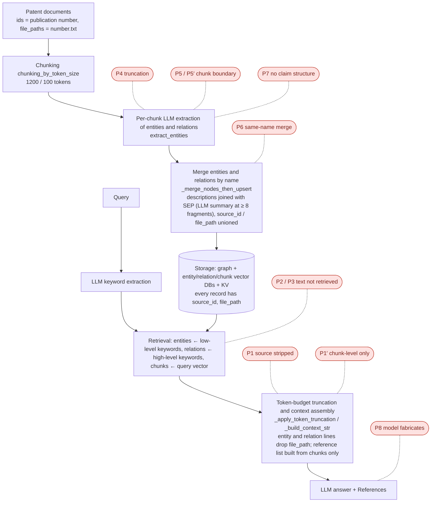
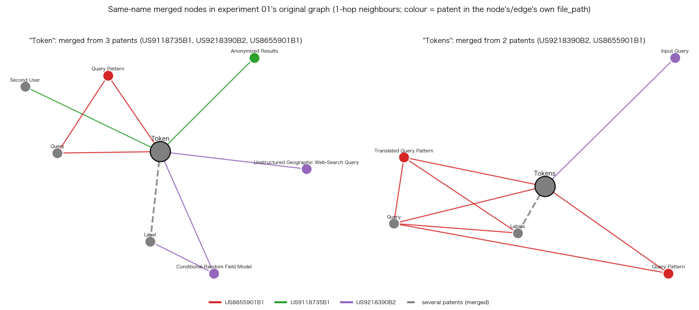

# LightRAG patent provenance: when graph facts reach the model, does it still know which patent they came from?

**English** · [中文](README_zh.md)

*The English documents are the maintained version; [README_zh.md](README_zh.md) is a translation checked against it (`python tools/check_translations.py README.md README_zh.md`). dot's original reports are in Chinese and kept unchanged in [`reports/original/`](reports/original/); English translations are in [`reports/translated/`](reports/translated/). See [Language of the materials](#language-of-the-materials).*

**In one sentence**: we indexed 20 US patents (title, abstract, all claims) with LightRAG v1.5.7 and asked questions over them. LightRAG records a source (`file_path`, `source_id`) for every entity and relation in storage, but **strips these source fields when it assembles the context sent to the LLM**. This is determined by the code and reproduced in all three full runs. In addition, **same-name entities are merged across patents** (38 of 612 nodes). As a result, graph facts reach the model without any way to tell which patent they belong to. We observed such facts being retrieved but not attributable: several times the model refused, or used the facts without a source; a wrong-patent attribution occurred only once across three runs. We did **not** observe a wrong answer caused directly by merging.

> Sources: storage vs. context in [`q11_api392_side_by_side.md`](experiments/01_baseline_index_qa/results/key_evidence/q11_api392_side_by_side.md) and the live reproduction [`context_provenance_demo.md`](experiments/01_baseline_index_qa/results/key_evidence/context_provenance_demo.md); merged-node counts in the [experiment 04 report](reports/translated/04_merged_node_audit_report_en.md); behavioural observations below. The experiments were run by an AI assistant (dot); this repository is the curated and audited version, see [docs/AUDIT.md](docs/AUDIT.md).

---

## Reproduce the core finding in 2 minutes

No API key and no paid call are needed. Install the pinned dependencies, then run the smoke test:

```bash
pip install -r requirements.txt
```

```bash
python tools/smoke_check.py
```

Expected: the last line reads `… checks, 0 FAIL, … WARN`. In a fresh clone the WARN lines are the complete API logs and the experiment-03 working directories (local-only, under `runs/`, not in this repository) and the missing `.env`; none of them is needed here. The checks that matter pass: LightRAG version and source hashes, the committed index (612 nodes / 994 edges, 12/12 files match [`SHA256SUMS.txt`](experiments/01_baseline_index_qa/index/SHA256SUMS.txt)), imports, chunking.

The live reproduction of P1 runs LightRAG's own query code on experiment 01's original index, which is committed in [`experiments/01_baseline_index_qa/index/`](experiments/01_baseline_index_qa/index/README.md) (the index built by the original run on 2026-10-29, 16 MB):

```bash
python tools/demo_context_provenance.py --replay-answer --md runs/demo.md
```

Expected output (JSON, identical on every run):

| field | value |
|---|---|
| `graph_store_node.file_path` | `US7991757B2.txt` |
| `llm_context_entity_line` | name, type and description only, no `file_path` |
| `counts.context_entity_lines_with_file_path` / `context_relation_lines_with_file_path` | `0` / `0` (of 82 / 82) |
| `vs_original_q11` | entities 82/82, relations 82/82, chunks 20/20 overlap |
| `api_calls` | 0 LLM, 0 embedding API |

The Markdown it writes is identical to the saved output [`context_provenance_demo.md`](experiments/01_baseline_index_qa/results/key_evidence/context_provenance_demo.md):

```bash
cmp runs/demo.md experiments/01_baseline_index_qa/results/key_evidence/context_provenance_demo.md && echo identical
```

The script works on a copy in `runs/demo_context/` and never writes into the committed index. On the first run `tiktoken` downloads its tokenizer file once (network needed); after that everything is offline.

## Problem overview

Five attribution categories: **design** (an intentional LightRAG trade-off), **implementation** (a LightRAG implementation problem), **config/env**, **experiment code**, **model generation** (the model fabricates although the evidence is complete; model `deepseek-ai/DeepSeek-V4.1-Flash`). Nothing was attributable to “implementation”.

| ID | Problem | Trigger | Expected | Actual | Evidence | Attribution | Reproduce |
|---|---|---|---|---|---|---|---|
| **P1** | Graph facts enter the prompt without their source | any `local/global/hybrid/mix` query | the model can tell which patent each entity/relation came from | structured result: 82/82 entities, 82/82 relations carry `file_path`; context sent to the model: 0/82, 0/82; same in all three runs | [live repro](experiments/01_baseline_index_qa/results/key_evidence/context_provenance_demo.md), [API 392](experiments/01_baseline_index_qa/results/key_evidence/q11_api392_side_by_side.md), [source](https://github.com/HKUDS/LightRAG/blob/28ff1b05f2ac3f3e6fa14dd2cd33656579bd0c9c/lightrag/operate.py#L5462-L5494) | design | `python tools/demo_context_provenance.py` (0 API calls, deterministic) |
| **P1′** | Adding sources back identifies the patent but not the claim | sources are chunk-level | claim can be located | +source fields: 3/3 right patent, 0/3 claim answered; +claim text: 3/3 | [ablation](experiments/02_provenance_ablation_and_chunk_control/results/key_evidence/ablation_source_fields.md) | design | `experiments/02_…/run.sh offline` |
| **P2** | Cross-document comparison misses one patent's text | retrieval budget below default (dot: chunk_top_k=8) | both texts in context | target chunks ranked 9 and 11, cut off; recovered with default-level budget | [Q06](experiments/01_baseline_index_qa/results/key_evidence/q06_budget.md) | config (secondary: design) | saved results; paid `run.sh live probe/budget` |
| **P3** | Publication number stated in the question, its text still not retrieved | purely semantic retrieval | the number acts as a filter | Q11 ranks 29 and 30 even at top-20 | [ranks](experiments/01_baseline_index_qa/results/key_evidence/q06_budget.md) | design | same |
| **P4** | Extraction output truncated, one relation lost | dot's 3500-token output cap | complete extraction | `finish_reason=length`, last relation incomplete and dropped | [API 191](experiments/01_baseline_index_qa/results/key_evidence/api191_truncation.md) | config | saved results |
| **P5** | Artificial mid-sentence split: complete relation not extracted | 93-token snippet, split mid-sentence | relation complete | same-chunk 3/3, split-in-sentence 0/3 (“provide something”) | [SAME/CROSS](experiments/02_provenance_ablation_and_chunk_control/results/key_evidence/same_vs_cross.md) | design (per-chunk extraction) | `experiments/02_…/run.sh offline` |
| **P5′** | Different chunk boundary, predicate missing from relation records | full patent, F01 | kept under both boundaries | original: same-chunk 3/3, cross-chunk 0/3, and the target sentence was **not** split in cross-chunk; cross-chunk kept the predicate 0/3, 1/3, 3/3 across the three runs | [F01](experiments/03_chunk_boundary_full_pipeline/results/key_evidence/f01_a3_vs_b3.md), [reproducibility](docs/REPRODUCIBILITY.md) | **to be verified** (runs disagree) | `experiments/03_…/run.sh offline` |
| **P6** | Same-name entities from different patents merged into one node | different patents use the same word | homonyms kept apart | 38/612 nodes multi-source, 6 of them homonym/role juxtapositions (e.g. Token) | [merged nodes](#merged-node-audit) | design | `experiments/04_…/run.sh offline` |
| **P7** | Claim dependencies not in the graph, citations document-level only | default entity types | traceable to claims | no claim entities or dependency edges; citations are `[n] <number>.txt` | [01 report §D](reports/translated/01_baseline_index_qa_report_en.md) | design | — |
| **P8** | Model gets the claim-dependency chain wrong despite complete evidence | naive, F01_B_r2 | answer as written | calls 4→5→6→8 “the stated sequence of dependencies” (claim 8 depends directly on 4); once in three runs | [F01_B_r2](experiments/03_chunk_boundary_full_pipeline/results/key_evidence/f01_b2_naive_dependency.md) | model generation | — |
| P9 | Ablation condition C: citation numbers conflict with the reference list | old reference list kept for a pure ablation | — | 3/3 write `[1]` as US7991757B2 | [ablation](experiments/02_provenance_ablation_and_chunk_control/results/key_evidence/ablation_source_fields.md) | experiment code | — |
| P10 | Parser run by selective AST execution instead of a normal import | imports stalled in that environment | — | equivalence checked only on the saved API 191 groups | [SETUP §1.1](docs/SETUP.md#11-imports-that-stall-for-minutes) | config/env | — |
| P11 | One resumed run exited before any API call | wrapper lacked `mkdir(parents=True)` | — | fixed, no effect on results | [03 report §A](reports/translated/03_chunk_boundary_full_pipeline_report_en.md) | experiment code | — |
| P12 | Distribution metadata said 1.5.8, 1.5.7 source actually ran | rounds 1–2 environment | — | 1.5.7 asserted in code, import path pointed to the 1.5.7 source | [AUDIT §c](docs/AUDIT.md) | config/env | — |

## LightRAG pipeline and where the problems occur

Based on the v1.5.7 source (function names can be found at the pinned commit):



(Rendered directly on GitHub; locally use VS Code's Markdown preview with a Mermaid extension, or Typora.)

## What each experiment shows

| Experiment | Document identity | Technical relations | Evidence provenance |
|---|---|---|---|
| [01 baseline index & QA](experiments/01_baseline_index_qa/README.md) (20 patents, Q01–Q11) | ✔ graph facts retrieved but unattributable (P1); target text not retrieved (P2, P3) | ✔ truncation loses a relation (P4); a genuinely cross-chunk claim 1/27 relation was extracted and merged | ✔ citations document-level only (P7); claims located correctly when the text is in context |
| [02 source-field ablation + artificial chunking](experiments/02_provenance_ablation_and_chunk_control/README.md) | ✔ adding source fields restores the patent (P1, P1′) | ✔ mid-sentence split loses the complete relation (P5) | ✔ right patent is not enough for the claim; citation mapping (P9) |
| [03 chunk boundary, full pipeline](experiments/03_chunk_boundary_full_pipeline/README.md) (3 patents × 2 boundaries × 3) | — (one patent per index) | ✔ boundary-sensitive predicate loss, F01 only (P5′, to be verified); F05, F04 kept | partial: with predicates missing from the graph, text retrieval still answered correctly; generation can still err (P8) |
| [04 merged-node audit](experiments/04_merged_node_audit/README.md) (read-only, no API) | ✔ 38 cross-patent nodes, 6 homonym juxtapositions (P6) | partial: 266 adjacent edges checked, no unsupported edge from merging | ✔ node → chunk → document mapping, 0 inconsistencies |

## Two levels of conclusions

**Structural** (determined by code; independent of model and randomness; reproduced in the original run and both reruns, see [reproducibility](#reproducibility)):

1. Before writing retrieved entities/relations into the prompt, v1.5.7 removes `file_path` and `created_at`; the model sees only name, type and description. The change was intentional: upstream commit [`d3fde609`](https://github.com/HKUDS/LightRAG/commit/d3fde60938c7e14f5e5dff07d4fbd4196e86cbce) (2025-08-18) is titled “remove file_path and created_at from context”, and earlier versions did include `file_path`. The commit gives no reason; “to save tokens” is only our guess ([operate.py L5462–L5494](https://github.com/HKUDS/LightRAG/blob/28ff1b05f2ac3f3e6fa14dd2cd33656579bd0c9c/lightrag/operate.py#L5462-L5494), [L5761–L5766](https://github.com/HKUDS/LightRAG/blob/28ff1b05f2ac3f3e6fa14dd2cd33656579bd0c9c/lightrag/operate.py#L5761-L5766)).
2. The Reference Document List in the prompt is built only from the chunks that made it into the context ([L5813–L5829](https://github.com/HKUDS/LightRAG/blob/28ff1b05f2ac3f3e6fa14dd2cd33656579bd0c9c/lightrag/operate.py#L5813-L5829)), and the system prompt asks the model to cite by the chunks' `reference_id` ([prompt.py L338–L356](https://github.com/HKUDS/LightRAG/blob/28ff1b05f2ac3f3e6fa14dd2cd33656579bd0c9c/lightrag/prompt.py#L338-L356)). A fact that comes only from the graph, with no corresponding chunk, has nothing citable in the prompt.
3. Same-name entities are merged into one node by name, descriptions joined with `<SEP>` (summarised by the LLM at `DEFAULT_FORCE_LLM_SUMMARY_ON_MERGE = 8` fragments), sources unioned ([`_merge_nodes_then_upsert`](https://github.com/HKUDS/LightRAG/blob/28ff1b05f2ac3f3e6fa14dd2cd33656579bd0c9c/lightrag/operate.py#L2428)). Once in the prompt, which description came from which patent is no longer visible.
4. Upstream checked on 2026-11-15: the newest GitHub release is `v1.5.8rc1` (a release candidate published that day; PyPI's newest version is still 1.5.7), and `main` is at [`c9ef958`](https://github.com/HKUDS/LightRAG/commit/c9ef958b3af62e5bb155cee395089a341342bfac). In both, `operate.py` is identical and point 1 still holds: the same block removes `file_path` and `created_at` ([main L5765–L5797](https://github.com/HKUDS/LightRAG/blob/c9ef958b3af62e5bb155cee395089a341342bfac/lightrag/operate.py#L5765-L5797)), and the context lines are written from the stripped records ([L6089–L6094](https://github.com/HKUDS/LightRAG/blob/c9ef958b3af62e5bb155cee395089a341342bfac/lightrag/operate.py#L6089-L6094)).

**Behavioural** (model output, possibly random; three full runs compared with one rubric, see [reproducibility](#reproducibility)):

- **Same in all three runs**: with the text in context, both modes completed the core task on 9/10 questions; Q06 missed the text at the baseline budget and recovered at default-level budgets; the source-field ablation (right patent 0/3, 3/3, 3/3; claim task 0/3, 0/3, 3/3); the artificial split (same-chunk 3/3, mid-sentence 0/3); experiment 03 mix, naive and forced core answers 18/18.
- When graph facts were unattributable, the model mostly refused (02 original-context condition, 9/9 over three runs), and sometimes used the facts without a source (Q06 mix in the 11-05 run).
- **Seen only once**: the Q11 misattribution and the P8 invented dependency chain, both in the original run.
- **Unstable**: F01's chunk-boundary effect (P5′).
- Quoted text was often not strictly verbatim (as the reports state).

## Reproducibility

After the original run, two more full reruns used the same model, parameters and code: one on 2026-11-05, run by the author on their own machine with dot's 11-05 adapted scripts, and one on 2026-11-15, run by Claude Code with the author's authorisation using this repository's `run.sh live` (ledger estimate about CNY 3.75). All three runs were scored with one rubric ([`SCORING_RUBRIC.md`](docs/SCORING_RUBRIC.md)), which agrees with dot's original labels 242/242 on the original run. The 15 judgments where the rule was uncertain or differed from the original run (7 on 11-05, 8 on 11-15) were reviewed first by Claude Code and then by the author on 2026-11-15; the two agreed on all of them. The other judgments are rule-based and were not reviewed one by one.

| Phenomenon | original | 11-05 | 11-15 | Reproduced? |
|---|---|---|---|---|
| P1 entity/relation lines with `file_path` in the Q11 prompt | 0/164 | 0/173 | 0/185 | yes (structural) |
| P6 multi-source nodes / nodes | 38/612 | 31/642 | 34/602 | yes; the nodes vary, “Token” was not merged on 11-05 |
| P7 claim entities in the graph | 0 | 0 | 0 | yes |
| Q01–Q10 core task (naive / mix) | 9/10, 9/10 | 9/10, 9/10 | 9/10, 9/10 | yes |
| Q06 misses text at baseline → completes with larger budget; target ranks 9 and 11 | yes | yes | yes | yes |
| Q11 “different patent family” misattribution | 1 | 0 | 0 | **no** |
| Ablation: right patent (original / +sources / +sources+claims) | 0/3, 3/3, 3/3 | 0/3, 3/3, 3/3 | 0/3, 3/3, 3/3 | yes |
| Artificial split: full relation kept (same-chunk / mid-sentence) | 3/3, 0/3 | 3/3, 0/3 | 3/3, 0/3 | yes |
| F01 cross-chunk keeps the predicate | 0/3 | 1/3 | 3/3 | **no** (unstable) |
| Experiment 03 mix / naive / forced core correct | 18/18 ×3 | 18/18 ×3 | 18/18 ×3 | yes |
| P8 naive wrong claim dependency | 1 | 0 | 0 | **no** |
| Extraction truncation (experiment 01 / 03) | 1 / 2 | 4 / 1 | 1 / 2 | every run, at different places |

Full comparison, possible reasons, and the calls and costs of the 11-15 rerun: [`docs/REPRODUCIBILITY.md`](docs/REPRODUCIBILITY.md).

## A typical example per problem

### P1 Graph facts enter the prompt without their source (main example)

On experiment 01's original index, the original Q11 retrieval (extended budget, mix) is rerun with LightRAG's own query pipeline, returning only the context, with no generation. Live command: `python tools/demo_context_provenance.py --replay-answer`. It makes 0 LLM and 0 embedding API calls and its output is deterministic.

| Location | Entity “Registration Module” |
|---|---|
| graph store (GraphML) | `file_path: US7991757B2.txt`, `source_id: US7991757B2-chunk-000<SEP>US7991757B2-chunk-001` |
| `aquery_data` structured result | `file_path: US7991757B2.txt`, `source_id: …chunk-000<SEP>…chunk-001` |
| the line sent to the model | `{"entity": "Registration Module", "type": "artifact", "description": "A module configured to provide functionality for registering an external recommender …"}` |

| | count | with `file_path` |
|---|---|---|
| structured entities / relations | 82 / 82 | 82 / 82 |
| context entity / relation lines | 82 / 82 | **0 / 0** |

Source: [`context_provenance_demo.md`](experiments/01_baseline_index_qa/results/key_evidence/context_provenance_demo.md). The query vectors are the bge-m3 vectors of the original Q11's three query texts (question, low-level keywords, high-level keywords), computed once on 2026-11-15 and saved (`experiments/01_baseline_index_qa/evidence/q11_query_vectors_bge-m3.json`; inputs identical to the original log). The demo only looks them up and calls no API. Retrieval **matches the original Q11 exactly**: 82/82 entities, 82/82 relations, 20/20 chunks; the context has the same lines, 33 of them in a different order (the cause cannot be determined from the saved data; see [FAQ](docs/FAQ.md#why-are-33-context-lines-in-a-different-order)). With `--replay-answer`, the answer replayed from the LLM cache is byte-identical to the original. That only shows question, parameters and keywords were the same; the answer was not regenerated.

The same holds in the original run. In the same Q11 call (extended budget, mix), the structured result had 5 entities and 4 relations from US7991757B2 and **0** chunks from it. The 146,853-character prompt actually sent to the model contains `US7991757B2` **0** times, and `file_path` and `source_id` 0 times each ([`q11_api392_side_by_side.md`](experiments/01_baseline_index_qa/results/key_evidence/q11_api392_side_by_side.md)).

### P1′ Adding sources back identifies the patent; locating the claim needs the text

Q11's retrieved context was frozen and only its presentation changed, 3 runs per condition ([02 report §2](reports/translated/02_provenance_ablation_and_chunk_control_report_en.md)):

| Condition | US7991757B2 identified | Claim task completed with evidence |
|---|---|---|
| original context | 0/3 (all three say the entities are “not linked to US7991757B2”) | 0/3 |
| +source fields (`publication_numbers`, `file_path`, `source_id` added to 82 relations) | 3/3 | 0/3 (appropriate refusal: no claim text) |
| +source fields + claim text | 3/3 | 3/3 |

### P2 / P3 Target patent text not retrieved

Q06 compares US7991757B2 with US8095432B1. At the baseline budget the former's text is absent from the context and both modes answer “insufficient evidence”. Its two chunks rank 9 and 11, while the baseline uses `chunk_top_k=8`. At default-level budgets (40/20/…/30000) both modes complete the comparison. Q11 is still not retrieved at top-20 (ranks 29, 30). Source: [`q06_budget.md`](experiments/01_baseline_index_qa/results/key_evidence/q06_budget.md).

### P4 Extraction output truncated

Extraction of one `US9218390B2` chunk stopped at 3500 tokens (`finish_reason=length`). The last line, `Class-Based Language Model Features → GEO_TRI_FIRST`, is incomplete; the official parser drops it and the edge is missing from the graph ([`api191_truncation.md`](experiments/01_baseline_index_qa/results/key_evidence/api191_truncation.md)).

### P5 Artificial mid-sentence split

The same text (Claims 26–28, 93 tokens) was cut at two different points. Relation descriptions for “Registration Module” ([`same_vs_cross.md`](experiments/02_provenance_ablation_and_chunk_control/results/key_evidence/same_vs_cross.md)):

| Condition | raw extraction output |
|---|---|
| same-chunk r1 | “The registration module is configured to allow a provider of an external recommender to provide **machine readable descriptions**.” |
| split-in-sentence r1–r3 | “The registration module is configured to allow a provider of an external recommender to provide **something**.” |

This is an artificial stress test. Under experiment 01's natural 1200/100 chunking, the genuinely cross-chunk claim 1/27 relation was extracted and merged.

### P5′ Full patent, different chunk boundary (to be verified)

F01 (US9589231B2), r3, no truncation in either condition. Same-chunk contains “The embedding of the new medical case, existing medical cases, and experts is based on a medical ontology.”; cross-chunk only has “The multidimensional representation of the medical case is computed based on the medical ontology.”. However, in the cross-chunk condition the claim 4 sentence lies **entirely in the first chunk**, so this is not a cut; it is an unstable extraction representation ([`f01_a3_vs_b3.md`](experiments/03_chunk_boundary_full_pipeline/results/key_evidence/f01_a3_vs_b3.md)). All F01 mix answers were still correct, because text retrieval compensated for the graph. In F05 and F04 the target predicates were kept under both boundaries.

In the two reruns, cross-chunk kept the target predicate 1/3 and 3/3 times (original 0/3). Across three runs there are 4 clean pairs: 3 show “same-chunk kept, cross-chunk lost”, 1 kept it on both sides. The effect is unstable, so it remains to be verified ([reproducibility](docs/REPRODUCIBILITY.md)).

### P6 Same-name merge: see the next section

### P7 Claim structure not in the graph

The default entity types contain no claims. With the text in context, the model reads “Claim 11 depends on 10…” from the text itself (Q08 and Q09 both correct), but the graph has no such dependency edges and citations stop at `[n] <number>.txt` ([01 report §D](reports/translated/01_baseline_index_qa_report_en.md)).

### P8 Fabrication despite complete evidence (model generation)

F01_B_r2's naive retrieval returned the full text of claims 4 and 8, and claim 8 begins “The method of claim 4”. Yet the answer says “Claim 4 → Claim 5 (concepts as dimensions) → Claim 6 (proximity matrix for similarity) → Claim 8 (UMLS basis). This is the stated sequence of dependencies.” ([`f01_b2_naive_dependency.md`](experiments/03_chunk_boundary_full_pipeline/results/key_evidence/f01_b2_naive_dependency.md)).

## Merged-node audit

Of the 612 nodes in experiment 01's original graph, 38 (6.21%) come from two or more patents. After item-by-item review, 32 are reasonable class/concept sharing (e.g. Processor, Memory) and 6 juxtapose homonyms or document-local roles. The review covered 98 node–patent sources and 266 adjacent edges. It found no unsupported edge produced by cross-patent merging, and no queries were run to show propagation into answers ([04 report](reports/translated/04_merged_node_audit_report_en.md)). The two most typical:



| Node | from patents | merged description (split at `<SEP>`, verbatim) | audit verdict |
|---|---|---|---|
| Token | US9118735B1, US9218390B2, US8655901B1 | (1) A replacement value used to anonymize results by replacing an identifier associated with the second user. (2) A unit of the input query to which a label is assigned. (3) A segment of a query in the first language containing one or more terms, associated with components of the first query pattern and annotated with labels. | homonym juxtaposition: (1) is an anonymisation substitute, (2)(3) are query tokens |
| Tokens | US9218390B2, US8655901B1 | (1) The series of tokens comprising the input query, to which labels are assigned. (2) Segments of a given query in the first language, each including one or more terms from the query. | reasonable sharing: both mean query tokens |

Figure and table are generated by `python tools/plot_merged_nodes.py` from [`full_graph.json`](experiments/01_baseline_index_qa/results/full_graph.json). The audit counts “reasonable sharing” and “homonym juxtaposition” separately. It notes that under a looser reading of ontology granularity the juxtapositions drop to 1 (Token). In the reruns, this “Token” merge reappeared with the same 3 patents on 11-15 but not on 11-05; “Tokens” was identical in all three runs ([reproducibility](docs/REPRODUCIBILITY.md)).

## Environment and reproduction

| Item | Value | Source |
|---|---|---|
| LightRAG | v1.5.7 (commit [`28ff1b05`](https://github.com/HKUDS/LightRAG/tree/28ff1b05f2ac3f3e6fa14dd2cd33656579bd0c9c)), source unmodified; this repo uses pip `lightrag-hku==1.5.7`, byte-identical `.py` | [AUDIT §c](docs/AUDIT.md) |
| Python | 3.10 (original 3.10.6) | [SETUP](docs/SETUP.md) |
| LLM / embedding | SiliconFlow: `deepseek-ai/DeepSeek-V4.1-Flash` (temperature 0, thinking off) / `BAAI/bge-m3` (1024-d) | `experiments/01_baseline_index_qa/evidence/full_settings.json` |
| Storage | JSON KV + NanoVectorDB + NetworkX (defaults) | 01 report §A |
| Data | 20 purposively selected patents from Dis2Pat (CC-BY-SA-4.0); 438 claims; 48 chunks | [data/README.md](data/README.md) |

### dot's settings vs LightRAG defaults

These settings affect **how often** a phenomenon appears. They do not affect P1's mechanism: the stripping code reads none of them, and the live reproduction uses the default budgets.

| Parameter | dot | v1.5.7 default | Affects |
|---|---|---|---|
| top_k / chunk_top_k | 12 / 8 | 40 / 20 | small budget made Q06 miss the text (P2) |
| entity / relation / total tokens | 2000 / 2000 / 8000 | 6000 / 8000 / 30000 | same |
| rerank | off | `enable_rerank=True` (needs a rerank model) | not tested |
| entity_extract_max_gleaning | 0 | 1 | may affect extraction completeness (P5, P5′); not tested |
| LLM output cap | 3500 tokens | none (provider default) | caused truncation (P4) |
| temperature / thinking | 0 / off | provider default | less randomness, not deterministic |
| chunk size / overlap | 1200 / 100 | 1200 / 100 | same |
| `include_references` | True | core `QueryParam` False, REST True | answers carry References |
| user_prompt | “Use only retrieved evidence. State the patent publication number and the exact Claim number **only when present in the evidence** … Do not invent links between patents.” | none | set on purpose by dot to prevent invented publication and claim numbers. Side effect: with no numbers in the KG context, the model refuses to attribute (how P1 shows up) |

### Reproduce

```bash
pip install -r requirements.txt
```

```bash
python tools/smoke_check.py
```

```bash
python tools/demo_context_provenance.py --replay-answer
```

| Experiment | Offline replay (free) | Real rerun (paid, after `run.sh live new`) | Original calls / time | Original cost estimate |
|---|---|---|---|---|
| 01 | `experiments/01_baseline_index_qa/run.sh offline` | `live preflight → smoke → full → probe → budget` | 95 LLM + 297 embedding / ~31 min of API time | CNY 1.56–1.77 |
| 02 | `experiments/02_provenance_ablation_and_chunk_control/run.sh offline` | `live prepare-ablation → prepare-chunks → ablation → chunks → parse` | 21 LLM / ~25 min | CNY 0.15–0.65 |
| 03 | `experiments/03_chunk_boundary_full_pipeline/run.sh offline` | `live F01 → F05 → F04 → naive` | 117 LLM + 247 embedding / ~19 min | CNY 1.08–1.33 |
| 04 | `experiments/04_merged_node_audit/run.sh offline` | none | 0 | 0 |

Costs are estimates from the returned usage at the then-public prices, not invoices (source: the cost section of each original report). Offline replay needs the local `runs/` (not in git). Paid steps need `.env` and `LRP_CONFIRM_COSTS=yes`. See [docs/SETUP.md](docs/SETUP.md).

## Limitations and open points

- **Number of runs**: three full runs (original, 11-05, 11-15). In each, experiment 01 ran every question once, and 02 and 03 ran every condition 3 times; temperature 0, no seed, not deterministic. Extraction differs slightly between runs; the three graphs have 612, 642 and 602 nodes.
- **The Q11 misattribution happened once**: in the original run the model called US7991757B2's registration capability “in a different patent family” and cited US10867122B1. The same context was replayed 9 times in 02 (three runs × 3), and both full reruns asked Q11 again; it never recurred. It is a possible consequence of P1, **not a stable phenomenon**. P8 likewise occurred only once.
- **P5′ to be verified**: F01's cross-chunk condition kept the predicate 0/3, 1/3 and 3/3 times across the three runs.
- **Sample**: the 20 patents were selected purposively (related topics), not at random; 03 used 3 patents. No error rates can be inferred.
- **Model**: a single LLM (DeepSeek-V4.1-Flash, a SiliconFlow alias whose backend version was not independently verified). Model dependence was not tested.
- **Scoring**: dot's original scoring is AI-assisted item-by-item checking against the source text, not independent human annotation (as each report states). The common three-run scoring is rule-based; 15 judgments were reviewed by Claude Code and then by the author ([record](docs/scoring/HUMAN_REVIEW.md)), the rest were not reviewed one by one. The rules were written after reading the original answers, so their 242/242 agreement on the original run does not by itself show they are as reliable on new answers.
- **Replay**: the README examples are saved original output. The live reproduction (`demo_context_provenance.py`) re-creates the original Q11 retrieval with saved bge-m3 query vectors (entities, relations and chunks all match). The LLM-cache replay returns the stored answer; it is not regenerated. Offline replay recomputes scoring and reports only; it calls no model.
- **Not tested**: default gleaning=1, rerank, no user_prompt, incremental insertion, the REST API, other models.

## Research questions this leads to

1. Can graph RAG keep assertion-level provenance (entity/relation → source span) through context assembly without a large token cost? (P1, P1′; 02 report §4)
2. Can patent claims and their dependency structure enter the graph as explicit evidence objects, so that answers are verifiable at the claim rather than document level? (P7; 01 report §D)
3. What source-scope constraints does same-name merging need to separate “shared superclass” from “homonym juxtaposition”? (P6; 04 report)
4. How can stage-wise metrics (extraction → merge → retrieval → generation) locate errors instead of judging only the final answer? (03 report §E: a correct answer and a complete graph predicate come apart)

## Layout

```
README.md / README_zh.md     English main page / Chinese translation
paths.py                    legacy folder layout → new layout (dot's scripts only changed where ROOT comes from)
requirements*.txt  .env.example
data/                       the 20 patents and round-1 data preparation (data/README.md)
experiments/0X_*/           README · run.sh · scripts/ (dot's, unchanged apart from the diffs) · results/ (incl. key_evidence/) · evidence/
experiments/01_*/index/     the original LightRAG index of experiment 01 (unchanged) and SHA256SUMS.txt
                            results_rerun_20261105/ · results_rerun_20261115/ · RERUN_ADAPTATION_20261105.diff · PATH_CHANGES.diff · CONTENT_CHANGES.diff
reports/original/           dot's original reports (Chinese, HTML + Markdown), the evidence
reports/translated/         English translations of those reports
docs/                       FAQ · SETUP · REPRODUCIBILITY · SCORING_RUBRIC · AUDIT · NAMING · RERUN_20261105_CHECK · scoring/
figures/                    merged-node figure
tools/                      smoke check, live reproduction, evidence extraction, scoring, rerun import, plotting, path sanitising
runs/                       local only (not in git): the other LightRAG working dirs, all API logs
```

## Language of the materials

- Everything written for this repository is in English: the documents above, the generated evidence files (`--lang en` is the default of every generator in `tools/`), code comments and terminal output of `tools/`.
- dot's original material is kept as it was, in Chinese: the reports in [`reports/original/`](reports/original/), and dot's experiment scripts in `experiments/*/scripts/` and `data/round1/scripts/`, which contain Chinese comments and Chinese report templates. [`reports/translated/`](reports/translated/) holds English translations of the reports (how they were made: [reports/README.md](reports/README.md)); the Chinese originals prevail.
- The author's human review of 15 scoring judgments was done in Chinese; [`docs/scoring/human_review_*.json`](docs/scoring/) store the original Chinese note (`note_zh`) and an English translation (`note_en`).
- Generators can also write Chinese (`--lang zh`); those copies are for local reading and are not committed.

## FAQ

Common questions (is the removal intentional, would it happen with defaults or a stronger model, can the misattribution be reproduced, what the sample supports, where the demo's query vectors come from, why 33 context lines are reordered): [docs/FAQ.md](docs/FAQ.md).

## Licence and acknowledgements

Code and data are licensed differently:

| Part | Licence | Notes |
|---|---|---|
| **Code**: new code in this repository (`paths.py`, `tools/`, …), dot's experiment scripts (`experiments/*/scripts/`, `data/round1/scripts/`), documentation | **MIT**, see [LICENSE](LICENSE) | © 2026 Xuchun Qiu |
| **Data**: the Dis2Pat subset under `data/` (20 records) and files derived from it, including experiment 01's LightRAG index in `experiments/01_baseline_index_qa/index/` | **CC-BY-SA-4.0**, see [data/LICENSE.md](data/LICENSE.md) | Source: Dis2Pat ([lj408/Dis2Pat](https://huggingface.co/datasets/lj408/Dis2Pat), revision `eda4a497`), attributed to the dataset authors; derived files shared under the same licence. MIT does not apply |

Dependency: LightRAG is MIT-licensed, © 2025 LightRAG Team (<https://github.com/HKUDS/LightRAG>). Its source is not vendored here; `lightrag-hku==1.5.7` is installed via pip.
