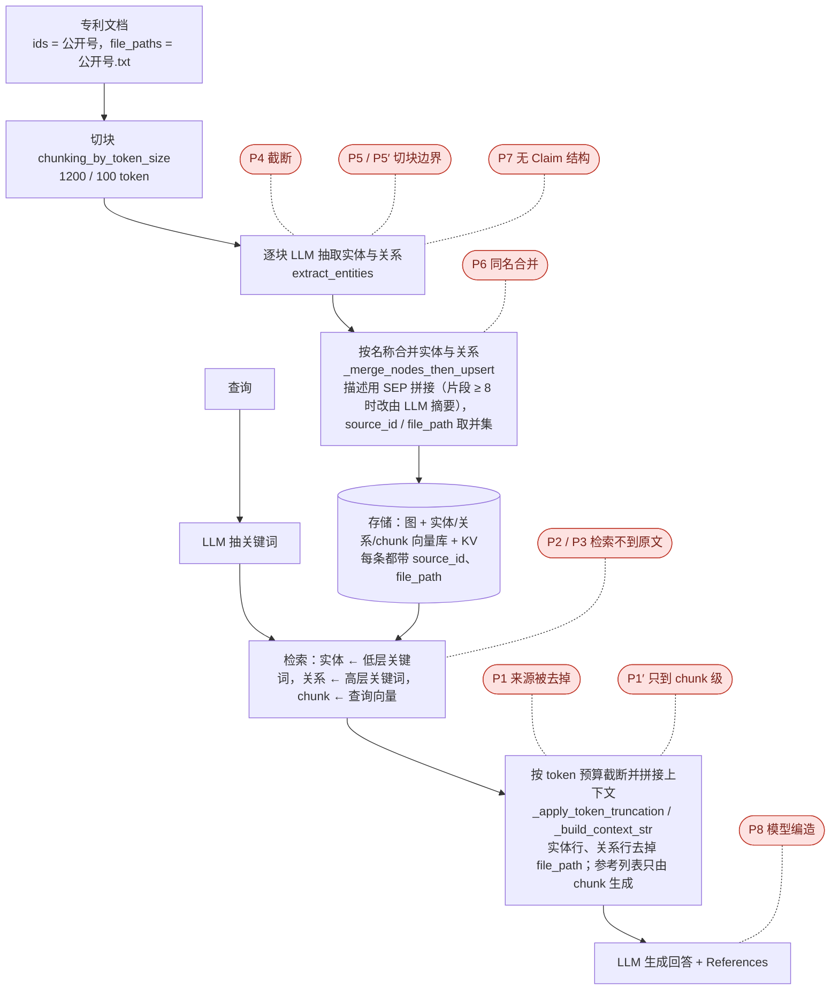
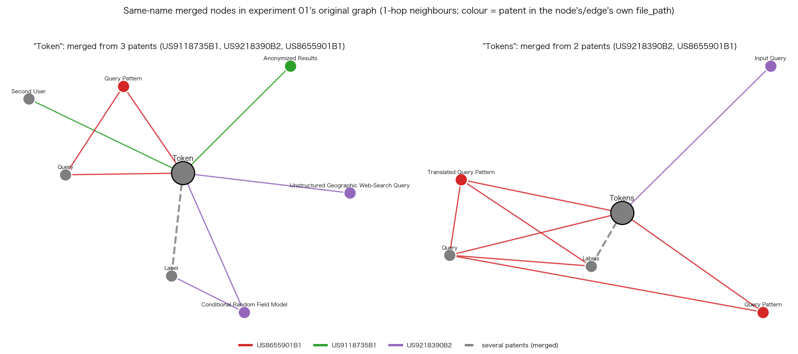

# LightRAG 专利溯源实验：图里的事实送到模型面前时，还知道来自哪篇专利吗？

[English](README.md) · **中文**

*本页是英文主页 [README.md](README.md) 的中文翻译，以英文版为准；两版的数字用 `python tools/check_translations.py README.md README_zh.md` 核对。仓库其余文档都是英文；dot 的原始中文报告原样保留在 [`reports/original/`](reports/original/)。*

**一句话**：用 LightRAG v1.5.7 对 20 篇美国专利（标题、摘要、全部 Claims）建图式索引并问答，发现 LightRAG 在存储里给每个实体和关系都记了来源（`file_path`、`source_id`），但**拼接给大模型的上下文时把这些来源字段去掉了**（由代码决定，三次完整运行都复现）；再加上**同名实体会跨专利合并**（612 个节点中有 38 个），模型看到的图事实已经无法对应到具体专利。我们观察到这些事实被检索到却无法归属：多次表现为拒答，或回答里有事实但没有出处；错误归属在三次运行中只出现过一次。**没有观察到**由合并直接造成的错误答案。

> 出处：存储与上下文对比见 [`q11_api392_side_by_side.md`](experiments/01_baseline_index_qa/results/key_evidence/q11_api392_side_by_side.md) 与现场复现 [`context_provenance_demo.md`](experiments/01_baseline_index_qa/results/key_evidence/context_provenance_demo.md)；合并节点数见 [实验 04 报告](reports/original/04_merged_node_audit_report_zh.md)；行为观察见下文各节。实验由 AI 助手 dot 执行，本仓库是整理与审计后的版本，审计过程见 [docs/AUDIT.md](docs/AUDIT.md)。

---

## 2 分钟复现核心发现

不需要 API key，也不产生费用。先安装固定版本的依赖，再跑冒烟测试：

```bash
pip install -r requirements.txt
```

```bash
python tools/smoke_check.py
```

预期：最后一行是 `… checks, 0 FAIL, … WARN`。在新克隆的仓库里，WARN 是完整 API 日志和实验 03 的工作目录（只留本地，在 `runs/` 下，不在本仓库）以及缺少的 `.env`，这里都用不到。要紧的检查都通过：LightRAG 版本与源码哈希、仓库里的索引（612 节点 / 994 边，12/12 个文件与 [`SHA256SUMS.txt`](experiments/01_baseline_index_qa/index/SHA256SUMS.txt) 一致）、导入、切块。

P1 的现场复现在实验 01 的原始索引上运行 LightRAG 自己的查询代码；这份索引已放进仓库 [`experiments/01_baseline_index_qa/index/`](experiments/01_baseline_index_qa/index/README.md)（2026-10-29 原始运行生成的索引，16 MB）：

```bash
python tools/demo_context_provenance.py --replay-answer --md runs/demo.md
```

预期输出（JSON，每次运行都相同）：

| 字段 | 值 |
|---|---|
| `graph_store_node.file_path` | `US7991757B2.txt` |
| `llm_context_entity_line` | 只有名称、类型、描述，没有 `file_path` |
| `counts.context_entity_lines_with_file_path` / `context_relation_lines_with_file_path` | `0` / `0`（共 82 / 82） |
| `vs_original_q11` | 实体 82/82、关系 82/82、chunk 20/20 重合 |
| `api_calls` | 0 次 LLM、0 次 Embedding API |

它写出的 Markdown 与保存好的输出 [`context_provenance_demo.md`](experiments/01_baseline_index_qa/results/key_evidence/context_provenance_demo.md) 完全相同：

```bash
cmp runs/demo.md experiments/01_baseline_index_qa/results/key_evidence/context_provenance_demo.md && echo identical
```

脚本在 `runs/demo_context/` 里的副本上运行，从不写入仓库里的索引。第一次运行时 `tiktoken` 会下载一次分词器文件（需要联网），之后全部离线。

## 问题总览

归因分五类：**设计**（LightRAG 有意的设计取舍）、**实现**（LightRAG 的实现问题）、**配置/环境**、**实验代码**、**模型生成**（证据齐全时模型仍然编造；模型为 `deepseek-ai/DeepSeek-V4.1-Flash`）。本次**没有**发现可归为“实现问题”的项。

| 编号 | 问题（一句话） | 触发条件 | 预期 | 实际 | 证据 | 归因 | 复现命令 |
|---|---|---|---|---|---|---|---|
| **P1** | 图事实进入提示时不带来源 | 任何 `local/global/hybrid/mix` 查询 | 模型能知道每条实体/关系出自哪篇专利 | 结构化返回里 82/82 实体、82/82 关系带 `file_path`；送进模型的上下文里 0/82、0/82；三次运行都如此 | [现场复现](experiments/01_baseline_index_qa/results/key_evidence/context_provenance_demo.md)、[API 392](experiments/01_baseline_index_qa/results/key_evidence/q11_api392_side_by_side.md)、[源码](https://github.com/HKUDS/LightRAG/blob/28ff1b05f2ac3f3e6fa14dd2cd33656579bd0c9c/lightrag/operate.py#L5462-L5494) | 设计 | `python tools/demo_context_provenance.py`（0 次 API、确定） |
| **P1′** | 补回来源字段能认对专利，但仍答不到 Claim | 来源只到 chunk 级 | 能定位到 Claim | 加来源字段 3/3 认对专利、0/3 答出 Claim；再加 Claim 原文 3/3 答对 | [消融](experiments/02_provenance_ablation_and_chunk_control/results/key_evidence/ablation_source_fields.md) | 设计 | `experiments/02_…/run.sh offline` |
| **P2** | 跨文档比较缺一篇专利的原文 | 检索预算低于默认（dot 设 chunk_top_k=8） | 两篇原文都进上下文 | 目标 chunk 排第 9、11，被截掉；扩到默认量级后恢复 | [Q06](experiments/01_baseline_index_qa/results/key_evidence/q06_budget.md) | 配置（次要：设计） | 看保存结果；付费复跑 `run.sh live probe/budget` |
| **P3** | 问题里写明公开号，仍检索不到该专利原文 | 纯语义检索 | 公开号能当过滤条件 | Q11 即使 top-20 仍排第 29、30 | [Q06/Q11 排名](experiments/01_baseline_index_qa/results/key_evidence/q06_budget.md) | 设计 | 同上 |
| **P4** | 抽取输出被截断，丢了一条关系 | dot 设输出上限 3500 token | 完整抽取 | `finish_reason=length`，最后一条关系没写完被丢弃 | [API 191](experiments/01_baseline_index_qa/results/key_evidence/api191_truncation.md) | 配置 | 看保存结果 |
| **P5** | 人为把句子切在中间，完整关系抽不出来 | 93-token 片段、句内切分 | 关系完整 | 同块 3/3，句内切分 0/3（只剩 “provide something”） | [SAME/CROSS](experiments/02_provenance_ablation_and_chunk_control/results/key_evidence/same_vs_cross.md) | 设计（逐块独立抽取） | `experiments/02_…/run.sh offline` |
| **P5′** | 换一种切块边界，关系记录里的谓词没了 | 完整专利，F01 | 两种边界都保留 | 原始：同块 3/3、跨块 0/3，且目标句在跨块条件下**没被切断**；跨块保留谓词在三次运行中分别为 0/3、1/3、3/3 | [F01](experiments/03_chunk_boundary_full_pipeline/results/key_evidence/f01_a3_vs_b3.md)、[可复现性](docs/REPRODUCIBILITY.md) | **待验证**（三次运行不一致） | `experiments/03_…/run.sh offline` |
| **P6** | 同名实体跨专利合并成一个节点 | 不同专利用同一个词 | 异义词分开 | 38/612 节点多源，其中 6 个是异义或角色并置（如 Token） | [合并节点](#合并节点审计) | 设计 | `experiments/04_…/run.sh offline` |
| **P7** | Claim 之间的从属关系不进图，引用只到文档级 | 默认实体类型 | 能追到 Claim | 图中没有 Claim 实体或从属边；引用是 `[n] 公开号.txt` | [01 报告 D 节](reports/original/01_baseline_index_qa_report_zh.md) | 设计 | — |
| **P8** | 证据齐全，模型仍写错 Claim 依赖链 | naive，F01_B_r2 | 按原文回答 | 把 4→5→6→8 说成“the stated sequence of dependencies”（Claim 8 直接依赖 4）；三次运行中只出现一次 | [F01_B_r2](experiments/03_chunk_boundary_full_pipeline/results/key_evidence/f01_b2_naive_dependency.md) | 模型生成 | — |
| P9 | 消融 C 条件引用编号与引用表冲突 | 为纯消融保留旧引用表 | — | 3/3 把 `[1]` 写成 US7991757B2 | [消融](experiments/02_provenance_ablation_and_chunk_control/results/key_evidence/ablation_source_fields.md) | 实验代码 | — |
| P10 | 解析器没有正常 import，而是用 AST 选择性执行 | 当时环境导入卡住 | — | 只对 API 191 已保存分组核对过等价 | [SETUP §1.1](docs/SETUP.md#11-imports-that-stall-for-minutes) | 配置/环境 | — |
| P11 | 一次续跑在调用 API 前退出 | 包装脚本缺 `mkdir(parents=True)` | — | 已修，不影响结果 | [03 报告 A 节](reports/original/03_chunk_boundary_full_pipeline_report_zh.md) | 实验代码 | — |
| P12 | 发行版元数据显示 1.5.8，实际运行 1.5.7 源码 | 第 1–2 轮环境 | — | 代码里断言了 1.5.7，路径指向 1.5.7 源码 | [AUDIT §c](docs/AUDIT.md) | 配置/环境 | — |

## LightRAG 流水线与问题出现的位置

以 v1.5.7 源码为准（函数名可在固定 commit 的源码中查到）：



（在 GitHub 网页上会直接渲染；本地可用 VS Code 的 Markdown 预览加 Mermaid 插件，或 Typora。）

## 四组实验各说明了什么

| 实验 | 文档身份 | 技术关系 | 证据溯源 |
|---|---|---|---|
| [01 基线索引与问答](experiments/01_baseline_index_qa/README.md)（20 篇，Q01–Q11） | ✔ 图事实被检索到却无法归属（P1）；检索不到目标原文（P2、P3） | ✔ 截断丢关系（P4）；真实跨块的 Claim 1/27 关系被成功抽取并合并 | ✔ 引用只到文档级（P7）；原文进上下文时能正确定位 Claim |
| [02 来源字段消融 + 人为切块](experiments/02_provenance_ablation_and_chunk_control/README.md) | ✔ 补回来源字段后能认对专利（P1、P1′） | ✔ 句内切分丢完整关系（P5） | ✔ 认对专利仍不足以定位 Claim；引用编号映射（P9） |
| [03 切块边界完整管线](experiments/03_chunk_boundary_full_pipeline/README.md)（3 篇 × 2 边界 × 3 次） | —（每个索引只有一篇专利） | ✔ 边界敏感的谓词遗漏，仅 F01（P5′，待验证）；F05、F04 保留 | 部分：图里缺谓词时，原文检索仍能答对；生成仍可能出错（P8） |
| [04 合并节点审计](experiments/04_merged_node_audit/README.md)（只读，无 API） | ✔ 38 个跨专利节点，6 个异义并置（P6） | 部分：266 条邻边逐条核对，未见由合并产生的无支持边 | ✔ 节点→chunk→文档的映射 0 不一致 |

## 两层结论

**结构性结论**（由代码决定，与模型、随机性无关；原始运行和两次复跑都复现，见[可复现性](#可复现性)）：

1. v1.5.7 把检索到的实体/关系写进提示前，删掉了 `file_path` 和 `created_at`，模型只看到名称、类型、描述。这是有意的改动：上游提交 [`d3fde609`](https://github.com/HKUDS/LightRAG/commit/d3fde60938c7e14f5e5dff07d4fbd4196e86cbce)（2025-08-18）标题为 “remove file_path and created_at from context”，之前上下文里带 `file_path`；提交没写原因，“为了节省 token”只是推测（[operate.py L5462–L5494](https://github.com/HKUDS/LightRAG/blob/28ff1b05f2ac3f3e6fa14dd2cd33656579bd0c9c/lightrag/operate.py#L5462-L5494)、[L5761–L5766](https://github.com/HKUDS/LightRAG/blob/28ff1b05f2ac3f3e6fa14dd2cd33656579bd0c9c/lightrag/operate.py#L5761-L5766)）。
2. 提示里的 Reference Document List 只由进入上下文的 chunk 生成（[L5813–L5829](https://github.com/HKUDS/LightRAG/blob/28ff1b05f2ac3f3e6fa14dd2cd33656579bd0c9c/lightrag/operate.py#L5813-L5829)），系统提示也要求只按 chunk 的 `reference_id` 引用（[prompt.py L338–L356](https://github.com/HKUDS/LightRAG/blob/28ff1b05f2ac3f3e6fa14dd2cd33656579bd0c9c/lightrag/prompt.py#L338-L356)）。所以只来自图、没有对应 chunk 的事实，在提示里没有可引用的出处。
3. 同名实体按名称合并成一个节点，描述用 `<SEP>` 拼接（片段达到 `DEFAULT_FORCE_LLM_SUMMARY_ON_MERGE = 8` 时改由 LLM 摘要），来源取并集（[`_merge_nodes_then_upsert`](https://github.com/HKUDS/LightRAG/blob/28ff1b05f2ac3f3e6fa14dd2cd33656579bd0c9c/lightrag/operate.py#L2428)）。进入提示后，各段描述分别来自哪篇专利，已经看不出来。
4. 2026-11-15 再次核对上游：GitHub 上最新的发布是 `v1.5.8rc1`（当天发布的候选版；PyPI 上最新仍是 1.5.7），`main` 位于 [`c9ef958`](https://github.com/HKUDS/LightRAG/commit/c9ef958b3af62e5bb155cee395089a341342bfac)。两者的 `operate.py` 完全相同，第 1 点仍然成立：同一段代码删掉 `file_path` 和 `created_at`（[main L5765–L5797](https://github.com/HKUDS/LightRAG/blob/c9ef958b3af62e5bb155cee395089a341342bfac/lightrag/operate.py#L5765-L5797)），上下文行由删过字段的记录写出（[L6089–L6094](https://github.com/HKUDS/LightRAG/blob/c9ef958b3af62e5bb155cee395089a341342bfac/lightrag/operate.py#L6089-L6094)）。

**行为性结论**（模型输出，可能随机；按同一评分标准比较了三次完整运行，见[可复现性](#可复现性)）：

- **三次都相同**：原文进上下文时，两种模式各完成 9/10 题核心任务；Q06 在基线预算下缺原文、在默认量级预算下恢复；来源字段消融的结果（认对专利 0/3、3/3、3/3，Claim 任务 0/3、0/3、3/3）；人为句内切分（同块 3/3、句内切分 0/3）；实验 03 中 mix、naive、forced 的核心回答都是 18/18。
- 图事实无法归属时，模型多数选择拒答（02 的“原始上下文”条件三次运行共 9/9），有时在回答中用了这些事实却不给出处（11-05 运行的 Q06 mix）。
- **只出现过一次**：Q11 错误归属、P8 编造从属链，都只在原始运行出现。
- **不稳定**：F01 的切块边界效应（P5′）。
- 引号内文字常常不是严格逐字（各报告自述）。

## 可复现性

原始运行之后又用同一模型、参数和代码做了两次完整复跑：2026-11-05 一次，由作者本人在本机用 dot 的 11-05 适配版脚本运行；2026-11-15 一次，由 Claude Code 经作者授权用本仓库的 `run.sh live` 运行，账本估算约 ¥3.75。三次运行用同一套评分标准（[`SCORING_RUBRIC.md`](docs/SCORING_RUBRIC.md)）评分；这套标准在原始运行上与 dot 的原评分 242/242 一致。规则拿不准或与原始运行不同的 15 项（11-05 7 项、11-15 8 项）先由 Claude Code 复核，再由作者本人于 2026-11-15 人工复核，两者结论全部一致；其余判定是规则判定，未逐项复核。

| 现象 | 原始 | 11-05 | 11-15 | 是否复现 |
|---|---|---|---|---|
| P1 Q11 提示中实体/关系行带 `file_path` 的条数 | 0/164 | 0/173 | 0/185 | 是（结构性） |
| P6 多源节点 / 总节点 | 38/612 | 31/642 | 34/602 | 是；具体节点会变，“Token” 在 11-05 未被合并 |
| P7 图中的 Claim 实体 | 0 | 0 | 0 | 是 |
| Q01–Q10 核心任务完成（naive / mix） | 9/10、9/10 | 9/10、9/10 | 9/10、9/10 | 是 |
| Q06 基线缺原文 → 扩大预算后完成；目标 chunk 排名（第 9、11 名） | 是 | 是 | 是 | 是 |
| Q11 “另一专利族”错误归属 | 1 | 0 | 0 | **否** |
| 消融：认对专利（原始 / +来源 / +来源+原文） | 0/3、3/3、3/3 | 0/3、3/3、3/3 | 0/3、3/3、3/3 | 是 |
| 人为切块：完整关系（同块 / 句内切分） | 3/3、0/3 | 3/3、0/3 | 3/3、0/3 | 是 |
| F01 跨块条件保留谓词 | 0/3 | 1/3 | 3/3 | **否**（不稳定） |
| 实验 03 mix / naive / forced 核心正确 | 18/18 ×3 | 18/18 ×3 | 18/18 ×3 | 是 |
| P8 naive 写错 Claim 依赖 | 1 | 0 | 0 | **否** |
| 抽取截断（实验 01 / 03） | 1 / 2 | 4 / 1 | 1 / 2 | 每次都出现，位置不同 |

完整对比、可能原因和 11-15 复跑的调用与费用见 [`docs/REPRODUCIBILITY.md`](docs/REPRODUCIBILITY.md)。

## 每个问题的典型例子

### P1 图事实进入提示时不带来源（主例）

在实验 01 原始索引上重跑原始 Q11（扩展预算、mix）的检索，用 LightRAG 自己的查询管线只取上下文、不生成。现场命令 `python tools/demo_context_provenance.py --replay-answer`，0 次 LLM、0 次 Embedding API，结果确定：

| 位置 | 实体 “Registration Module” |
|---|---|
| 图存储（GraphML） | `file_path: US7991757B2.txt`，`source_id: US7991757B2-chunk-000<SEP>US7991757B2-chunk-001` |
| `aquery_data` 结构化返回 | `file_path: US7991757B2.txt`，`source_id: …chunk-000<SEP>…chunk-001` |
| 送进模型的上下文那一行 | `{"entity": "Registration Module", "type": "artifact", "description": "A module configured to provide functionality for registering an external recommender …"}` |

| | 条数 | 其中带 `file_path` |
|---|---|---|
| 结构化返回的实体 / 关系 | 82 / 82 | 82 / 82 |
| 上下文中的实体行 / 关系行 | 82 / 82 | **0 / 0** |

出处：[`context_provenance_demo.md`](experiments/01_baseline_index_qa/results/key_evidence/context_provenance_demo.md)。查询向量是原始 Q11 的三段查询文本（问题、低层关键词、高层关键词）的 bge-m3 向量，2026-11-15 算过一次后存档（`experiments/01_baseline_index_qa/evidence/q11_query_vectors_bge-m3.json`，输入与原始日志逐字相同）。演示时只查表，不调用 API。检索结果与原始 Q11 **完全重合**：实体 82/82、关系 82/82、chunk 20/20；上下文的行与原始请求相同，其中 33 行先后顺序不同（原因无法从保存的数据中确定，见 [FAQ](docs/FAQ.md#why-are-33-context-lines-in-a-different-order)）。加 `--replay-answer` 时，从 LLM 缓存取回的回答与原始回答逐字相同。这只说明问题、参数和关键词与原始相同，回答并非重新生成。

同样的情况出现在原始运行里：Q11（扩展预算、mix）的同一次调用中，结构化返回有 5 个实体、4 条关系来自 US7991757B2，**0 个** chunk 来自它；实际发给模型的 146,853 字符的提示里，`US7991757B2` 出现 **0** 次，`file_path` 和 `source_id` 都是 0 次（[`q11_api392_side_by_side.md`](experiments/01_baseline_index_qa/results/key_evidence/q11_api392_side_by_side.md)）。

### P1′ 补回来源只能认对专利，定位 Claim 需要原文

冻结 Q11 的检索上下文，只改呈现方式，每个条件跑 3 次（[02 报告 §2](reports/original/02_provenance_ablation_and_chunk_control_report_zh.md)）：

| 条件 | 认对 US7991757B2 | 有证据地完成 Claim 任务 |
|---|---|---|
| 原始上下文 | 0/3（三次都说图里的实体“not linked to US7991757B2”） | 0/3 |
| +来源字段（82 条关系加 `publication_numbers`、`file_path`、`source_id`） | 3/3 | 0/3（恰当拒答：没有 Claim 原文） |
| +来源字段+Claim 原文 | 3/3 | 3/3 |

### P2 / P3 检索不到目标专利原文

Q06 比较 US7991757B2 与 US8095432B1。基线上下文里没有前者的原文，两种模式都回答“证据不足”。前者两个 chunk 的向量排名是第 9、11，基线 `chunk_top_k=8`。扩到默认量级（40/20/…/30000）后两种模式都完成了比较。Q11 在 top-20 下仍取不到（排第 29、30）。出处：[`q06_budget.md`](experiments/01_baseline_index_qa/results/key_evidence/q06_budget.md)。

### P4 抽取输出被截断

`US9218390B2` 一个 chunk 的抽取在 3500 token 处被截断（`finish_reason=length`），最后一行 `Class-Based Language Model Features → GEO_TRI_FIRST` 没写完，官方解析器把它丢弃，图里缺这条边（[`api191_truncation.md`](experiments/01_baseline_index_qa/results/key_evidence/api191_truncation.md)）。

### P5 人为句内切分

同一段 Claims 26–28（93 token），只改切点。“Registration Module” 的关系描述（[`same_vs_cross.md`](experiments/02_provenance_ablation_and_chunk_control/results/key_evidence/same_vs_cross.md)）：

| 条件 | 原始抽取输出 |
|---|---|
| 同块 r1 | “The registration module is configured to allow a provider of an external recommender to provide **machine readable descriptions**.” |
| 句内切分 r1–r3 | “The registration module is configured to allow a provider of an external recommender to provide **something**.” |

这是人为构造的压力测试。在实验 01 的自然切块（1200/100）里，真正跨块的 Claim 1/27 关系是被成功抽取并合并了的。

### P5′ 完整专利换切块边界（待验证）

F01（US9589231B2）r3 两条件都没有截断。同块条件的关系里有 “The embedding of the new medical case, existing medical cases, and experts is based on a medical ontology.”；跨块条件只有 “The multidimensional representation of the medical case is computed based on the medical ontology.”。但 Claim 4 这句话在跨块条件下**整句都在第一个 chunk 里**，所以这不是“切断”，而是抽取表示不稳定（[`f01_a3_vs_b3.md`](experiments/03_chunk_boundary_full_pipeline/results/key_evidence/f01_a3_vs_b3.md)）。所有 F01 的 mix 回答都仍然答对（原文检索弥补了图的遗漏）。F05、F04 的目标谓词在两种边界下都保留。

两次复跑中，跨块条件保留目标谓词的次数分别是 1/3 和 3/3（原始为 0/3）。三次运行一共有 4 对干净配对，3 对是“同块保留、跨块丢失”，1 对两边都保留。这个效应不稳定，所以仍标为待验证（[可复现性](docs/REPRODUCIBILITY.md))。

### P6 同名合并：见下节

### P7 Claim 结构不进图

默认实体类型里没有 Claim。原文进入上下文时，模型能从文字里读出“Claim 11 depends on 10…”（Q08、Q09 都答对），但图里没有这类从属边，引用也只到 `[n] 公开号.txt`（[01 报告 D 节](reports/original/01_baseline_index_qa_report_zh.md)）。

### P8 证据齐全仍编造（模型生成）

F01_B_r2 的 naive 检索已返回 Claim 4、8 的完整原文（Claim 8 原文以 “The method of claim 4” 开头），回答却写 “Claim 4 → Claim 5 (concepts as dimensions) → Claim 6 (proximity matrix for similarity) → Claim 8 (UMLS basis). This is the stated sequence of dependencies.”（[`f01_b2_naive_dependency.md`](experiments/03_chunk_boundary_full_pipeline/results/key_evidence/f01_b2_naive_dependency.md)）。

## 合并节点审计

实验 01 的原始图共 612 个节点，其中 38 个（6.21%）来自两篇或以上专利。逐项审阅后，32 个是合理的类/概念共享（如 Processor、Memory），6 个是异义或文档局部角色并置。审阅涉及 98 条节点—专利来源、266 条邻边，未发现由跨专利合并产生的无支持边，也没有运行查询去证明错误会传播到答案（[04 报告](reports/original/04_merged_node_audit_report_zh.md)）。最典型的两个：



| 节点名 | 来自哪些专利 | 合并后的描述（按 `<SEP>` 拆开，原样） | 审计结论 |
|---|---|---|---|
| Token | US9118735B1, US9218390B2, US8655901B1 | (1) A replacement value used to anonymize results by replacing an identifier associated with the second user. (2) A unit of the input query to which a label is assigned. (3) A segment of a query in the first language containing one or more terms, associated with components of the first query pattern and annotated with labels. | 异义并置：(1) 是匿名化替代值，(2)(3) 是查询词元 |
| Tokens | US9218390B2, US8655901B1 | (1) The series of tokens comprising the input query, to which labels are assigned. (2) Segments of a given query in the first language, each including one or more terms from the query. | 合理共享：两篇都指查询词元 |

图与表由 `python tools/plot_merged_nodes.py` 从 [`full_graph.json`](experiments/01_baseline_index_qa/results/full_graph.json) 生成。复跑中，“Token” 的这种合并在 11-15 由同样 3 篇专利再次出现，在 11-05 没有出现；“Tokens” 三次都相同（[可复现性](docs/REPRODUCIBILITY.md))。审计报告把“合理共享”与“异义并置”分开计数，并指出：若对本体粒度取宽松解释，异义并置可降为 1 个（Token）。

## 环境与复现

| 项 | 值 | 出处 |
|---|---|---|
| LightRAG | v1.5.7（commit [`28ff1b05`](https://github.com/HKUDS/LightRAG/tree/28ff1b05f2ac3f3e6fa14dd2cd33656579bd0c9c)），源码未修改；仓库用 pip `lightrag-hku==1.5.7`，`.py` 逐字节相同 | [AUDIT §c](docs/AUDIT.md) |
| Python | 3.10（原始 3.10.6） | [SETUP](docs/SETUP.md) |
| LLM / Embedding | SiliconFlow：`deepseek-ai/DeepSeek-V4.1-Flash`（temperature 0，关闭思考）/ `BAAI/bge-m3`（1024 维） | `experiments/01_baseline_index_qa/evidence/full_settings.json` |
| 存储 | JSON KV + NanoVectorDB + NetworkX（默认） | 01 报告 A 节 |
| 数据 | Dis2Pat（CC-BY-SA-4.0）中目的性选取的 20 篇；438 条 Claims；48 个 chunk | [data/README.md](data/README.md) |

### dot 的设置与 LightRAG 默认值

这些设置会影响现象**出现的频率**，但不影响 P1“拼上下文时去掉来源”这个机制：去掉来源的代码不读这些参数，现场复现用的就是默认预算。

| 参数 | dot 的设置 | v1.5.7 默认 | 影响什么 |
|---|---|---|---|
| top_k / chunk_top_k | 12 / 8 | 40 / 20 | 小预算让 Q06 缺原文（P2） |
| 实体 / 关系 / 总上下文 token | 2000 / 2000 / 8000 | 6000 / 8000 / 30000 | 同上 |
| rerank | 关闭 | `enable_rerank=True`（需另配 rerank 模型） | 未测 |
| entity_extract_max_gleaning | 0 | 1 | 可能影响抽取完整性（P5、P5′），未测 |
| LLM 输出上限 | 3500 token | 不设（用服务端默认） | 导致截断（P4） |
| temperature / 思考 | 0 / 关闭 | 服务端默认 | 降低随机性，但不保证确定 |
| chunk 大小 / 重叠 | 1200 / 100 | 1200 / 100 | 相同 |
| `include_references` | True | 核心 `QueryParam` 默认 False，REST 默认 True | 让回答带 References |
| user_prompt | “Use only retrieved evidence. State the patent publication number and the exact Claim number **only when present in the evidence** … Do not invent links between patents.” | 无 | dot 有意设置，用来防止模型编造公开号和 Claim 号。副作用：KG 上下文里没有公开号，模型就会拒绝归属（P1 的表现形式） |

### 复现

```bash
pip install -r requirements.txt
```

```bash
python tools/smoke_check.py
```

```bash
python tools/demo_context_provenance.py --replay-answer
```

| 实验 | 离线重放（免费） | 真实复跑（付费，先 `run.sh live new`） | 原始调用量 / 耗时 | 原始估算费用 |
|---|---|---|---|---|
| 01 | `experiments/01_baseline_index_qa/run.sh offline` | `live preflight → smoke → full → probe → budget` | 95 LLM + 297 Embedding / API 区间约 31 分钟 | ¥1.56–1.77 |
| 02 | `experiments/02_provenance_ablation_and_chunk_control/run.sh offline` | `live prepare-ablation → prepare-chunks → ablation → chunks → parse` | 21 LLM / 约 25 分钟 | ¥0.15–0.65 |
| 03 | `experiments/03_chunk_boundary_full_pipeline/run.sh offline` | `live F01 → F05 → F04 → naive` | 117 LLM + 247 Embedding / 约 19 分钟 | ¥1.08–1.33 |
| 04 | `experiments/04_merged_node_audit/run.sh offline` | 无 | 0 | ¥0 |

费用是按当时公开价对返回 usage 的估算，不是账单（出处：各原始报告的成本一节）。离线重放需要本地 `runs/`（不进 git），付费步骤需要 `.env` 并设置 `LRP_CONFIRM_COSTS=yes`。详见 [docs/SETUP.md](docs/SETUP.md)。

## 局限与待验证

- **运行次数**：三次完整运行（原始、11-05、11-15）。每次实验 01 每题一次，02、03 每个条件 3 次；temperature 0，没有 seed，不保证确定。抽取每次略有不同，三张图的节点数为 612、642、602。
- **Q11 错误归属只出现过一次**：原始运行中，模型把 US7991757B2 的注册能力说成 “in a different patent family”，并引用了 US10867122B1。02 用同一上下文共重放 9 次（三次运行 × 3），两次完整复跑也重新做了这道题，都没有再出现。所以它只能算 P1 可能导致的一种后果，**不是稳定现象**。P8 同样只出现过一次。
- **P5′ 待验证**：F01 跨块条件保留谓词 0/3、1/3、3/3，三次运行不一致。
- **样本**：20 篇专利是目的性选取（主题相近），不是随机样本；03 只有 3 篇。不能据此推断错误率。
- **模型**：只用了一个 LLM（DeepSeek-V4.1-Flash，SiliconFlow 别名，未独立验证其后端版本）。是否随模型而变，没测。
- **评分**：dot 的原评分是 AI 辅助逐条核对原文，不是独立人工标注（各报告自述）。三次运行的统一评分由规则给出；其中 15 项经 Claude Code 复核和作者本人人工复核（[记录](docs/scoring/HUMAN_REVIEW.md)），其余未逐项复核。规则是在看过原始回答之后写的，所以在原始运行上的 242/242 一致率不能直接说明它在新回答上同样可靠。
- **回放**：README 展示的例子都来自保存好的原始结果。现场复现（`demo_context_provenance.py`）用存档的 bge-m3 查询向量重现了原始 Q11 的检索（实体、关系、chunk 全部重合）。LLM 缓存回放取回的是原来存下的回答，不是重新生成。离线重放只重新计算评分和报告，不重新调用模型。
- **未测**：默认 gleaning=1、rerank、不加 user_prompt、增量插入、REST 接口、其他模型。

## 由此引出的研究问题

1. 图式 RAG 能否在上下文拼接时保留断言级来源（实体/关系 → 原文区间），而又不显著增加 token 开销？（P1、P1′；02 报告 §4）
2. 专利 Claim 的从属结构能否作为显式证据对象进入图，让回答可以核验到 Claim 而不只是文档？（P7；01 报告 D 节）
3. 同名实体合并需要什么样的来源作用域约束，才能区分“共享上位类”和“异义并置”？（P6；04 报告）
4. 如何用分阶段指标（抽取→合并→检索→生成）定位错误，而不是只看最终答案对不对？（03 报告 E 节：答案正确与图中谓词完整会分离）

## 目录

```
README.md / README_zh.md     英文主页 / 中文翻译
paths.py                    旧目录布局 → 新目录（dot 的脚本只改了 ROOT 的来源）
requirements*.txt  .env.example
data/                       20 篇专利与 round1 数据准备（data/README.md）
experiments/0X_*/           README · run.sh · scripts/（dot 的原脚本，改动见各 diff）· results/（含 key_evidence/）· evidence/
experiments/01_*/index/     实验 01 原始运行的 LightRAG 索引（原样）与 SHA256SUMS.txt
                            results_rerun_20261105/ · results_rerun_20261115/ · RERUN_ADAPTATION_20261105.diff · PATH_CHANGES.diff · CONTENT_CHANGES.diff
reports/original/           dot 的原始报告（中文，HTML + Markdown），即证据
reports/translated/         这些报告的英文翻译
docs/                       FAQ · SETUP · REPRODUCIBILITY · SCORING_RUBRIC · AUDIT · NAMING · RERUN_20261105_CHECK · scoring/
figures/                    合并节点图
tools/                      冒烟测试、现场复现、证据抽取、评分、复跑导入、画图、路径脱敏
runs/                       只留本地（不进 git）：其余 LightRAG 工作目录、全部 API 日志
```

## 材料的语言

- 为本仓库写的内容都是英文：上面这些文档、生成的证据文件（`tools/` 里每个生成脚本默认 `--lang en`）、`tools/` 的代码注释和终端输出。
- dot 的原始材料保持原样，是中文：[`reports/original/`](reports/original/) 里的报告，以及 `experiments/*/scripts/`、`data/round1/scripts/` 里 dot 的实验脚本（含中文注释和中文报告模板）。[`reports/translated/`](reports/translated/) 是这些报告的英文翻译（翻译方式见 [reports/README.md](reports/README.md)），以中文原件为准。
- 作者本人对 15 项评分判定的人工复核用中文完成；[`docs/scoring/human_review_*.json`](docs/scoring/) 同时存中文原文（`note_zh`）和英文翻译（`note_en`）。
- 生成脚本也能输出中文（`--lang zh`），那些副本只在本地阅读，不进 git。

## 常见问题

常见问题（去掉来源是不是有意的、默认参数或更强的模型下是否还会出现、错误归属能否复现、样本能支持什么、演示的查询向量从哪来、为什么有 33 行上下文顺序不同）见 [docs/FAQ.md](docs/FAQ.md)（英文）。

## 许可与致谢

仓库里的代码和数据用不同的许可，分开说明：

| 部分 | 许可 | 说明 |
|---|---|---|
| **代码**：仓库新写的代码（`paths.py`、`tools/` 等）、dot 的实验脚本（`experiments/*/scripts/`、`data/round1/scripts/`）、文档 | **MIT**，见 [LICENSE](LICENSE) | © 2026 Xuchun Qiu |
| **数据**：`data/` 下的 Dis2Pat 子集（20 条记录）及其派生文件，包括 `experiments/01_baseline_index_qa/index/` 里实验 01 的 LightRAG 索引 | **CC-BY-SA-4.0**，见 [data/LICENSE.md](data/LICENSE.md) | 来源：Dis2Pat（[lj408/Dis2Pat](https://huggingface.co/datasets/lj408/Dis2Pat)，revision `eda4a497`），署名归数据集作者；派生文件按同一许可共享。不适用 MIT |

依赖：LightRAG 采用 MIT License，© 2025 LightRAG Team（<https://github.com/HKUDS/LightRAG>）。本仓库不附带其源码，通过 pip 安装 `lightrag-hku==1.5.7`。
